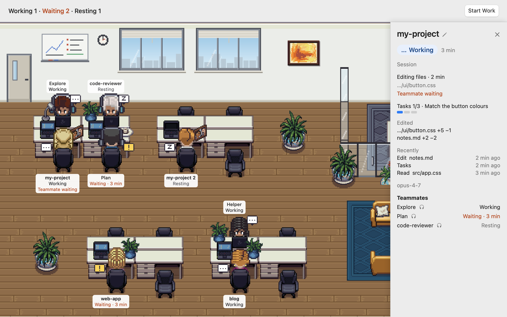

# Agent Overtime

[English](README.md) · 한국어

**불 꺼지지 않는 에이전트 사무실.** Claude Code 세션과 서브에이전트가 일하는 모습을 픽셀 사무실로 보여 주는 작은 맥 앱입니다. 누가 일하고, 누가 내 답을 기다리고, 누가 쉬고, 누가 퇴근했는지 한눈에 봅니다.

Claude Code 와 함께 씁니다. Anthropic 과 관계없는 오픈소스 앱입니다.

<picture>
  <source media="(prefers-color-scheme: dark)" srcset="docs/images/office-dark.png">
  
</picture>

| 상태 | 뜻 | 화면 |
|---|---|---|
| 일하는 중 | 답을 만드는 중 | 책상에 앉아 있고 노트북이 켜짐, `…` 말풍선 |
| 답 기다림 · n분째 | 내가 허락하거나 답해야 다음으로 감 | 앉은 채 머리 위 `!` 말풍선이 통통 튐 |
| 쉬는 중 | 할 일을 끝내고 다음 지시를 기다림 | 의자에서 꾸벅꾸벅 졺, `z` 말풍선 |
| 퇴근 | 세션이 꺼짐 | 문으로 나감. 그 섬에 아직 일하는 사람이 있는 동안 자리에 흐린 이름표가 남음 |

- 마주 보는 책상 네 개짜리 섬에, 문에 가까운 자리부터, 세션이 켜져 있는 동안만 앉습니다. 세션 이름표는 폴더 이름이고, 같은 폴더의 두 번째 세션은 "이름 2" 입니다.
- 서브에이전트는 문으로 걸어 들어와 자기를 부른 사람의 섬에 앉습니다. 부른 사람이 그 자리로 걸어가 일을 맡기고, 끝난 서브에이전트는 부른 사람 자리에 와서 보고하고 나갑니다. 세션이 서브에이전트 둘 이상에게 일을 맡기고 기다리면 통유리 회의실에 모입니다. 부른 쪽이 계속 자기 일을 하면, 그동안 일하는 서브에이전트는 헤드폰을 쓰고 회의에 가지 않습니다.
- 캐릭터나 이름표를 누르면 옆 창이 열립니다: 상태와 몇 분째, 쓰는 도구 종류, 서브에이전트. 거기서 이름 옆 연필 버튼으로 별명을 붙이고, 별명은 이 맥에만 둡니다.
- 답 기다리는 세션이 있으면 메뉴바 아이콘이 `! 2` 처럼 바뀝니다. 모든 것이 이 맥 안에서만 돕니다.

## 시작하기

### 1. 설치

```
brew install --cask ykwimk/tap/agent-overtime
```

또는 [Releases](https://github.com/ykwimk/agent-overtime/releases) 에서 `.dmg` 를 받아 `AgentOvertime.app` 을 **응용 프로그램** 폴더로 끕니다. 이름은 그대로 둡니다. 플러그인이 `/Applications/AgentOvertime.app` 또는 `~/Applications/AgentOvertime.app` 에서 앱을 찾습니다.

### 2. 첫 실행

Apple 공증을 받지 않은 앱이라 처음 열면 맥이 막습니다. **시스템 설정 > 개인정보 보호 및 보안** 맨 아래의 **Open Anyway (그래도 열기)** 를 누르고, 다시 뜨는 창에서 **열기**. macOS 13·14 는 Finder 에서 우클릭 > **열기** 도 됩니다. macOS 15 부터는 시스템 설정 길 하나뿐입니다.

### 3. 연결

앱이 처음 여는 창의 **연결 명령 복사** 를 누르고, Claude Code 에 두 줄을 붙여 넣습니다.

```
/plugin marketplace add ykwimk/agent-overtime#v0.3.0
/plugin install agent-overtime@agent-overtime
```

설치 창에서 **Install for you (user scope)** 를 고르면 이 맥의 모든 프로젝트에 적용됩니다. 이미 켜 둔 세션은 `/reload-plugins` 를 한 번 쳐야 소식이 옵니다.

### 4. 1분 확인

Claude Code 에 한 마디 보냅니다. 캐릭터가 사무실 문으로 걸어 들어와 내 폴더 이름의 자리에 앉습니다 (`~/my-project` 면 이름표가 `my-project`). 30초가 지나도 안 오면 아래 첫 질문을 봐 주세요.

## 자주 묻는 것

**Homebrew 가 "untrusted tap" 이라고 해요.**
설치 명령을 이름 그대로 다시 쳐 주세요: `brew install --cask ykwimk/tap/agent-overtime`. 이름을 다 쓰면 Homebrew 가 tap 전체가 아니라 이 앱 하나만 믿고 설치합니다.

**캐릭터가 안 나와요.**
Claude Code 의 `/plugin` 목록에서 agent-overtime 이 켜져 있나요? 미리 켜 둔 세션인가요 (그 세션에서 `/reload-plugins` 를 한 번)? 앱이 응용 프로그램 폴더에 있나요? 설치한 뒤 Claude Code 에 한 마디 보냈나요?

**먼저 켠 세션이 사무실에 안 보여요.**
그 세션에서 `/reload-plugins` 를 한 번 쳐 주세요. 앱보다 먼저 켠 세션은 다음에 움직일 때 나타납니다.

**왜 맥이 막나요? 열어도 되나요?**
공증은 유료 Apple 개발자 프로그램이 필요해서 아직 하지 않았어요. 코드는 모두 공개되어 있고, 받은 파일이 릴리스와 같은지 직접 확인할 수 있어요 ([받은 파일 확인](#받은-파일-확인)).

**권한을 허락했는데 계속 답 기다림이에요.**
Claude Code 가 "허락됨" 소식을 따로 주지 않아서, 그 세션의 다음 소식 때 바뀝니다 (긴 명령이면 몇 분).

**다른 에이전트도 되나요?**
아직은 Claude Code 만 됩니다. 다른 에이전트는 [로드맵](#로드맵) 에 있어요.

**끄거나 지우려면요?**
Claude Code 에서 `/plugin` 으로 `agent-overtime` 을 끄거나 지웁니다. 그다음 `brew uninstall --cask agent-overtime` 또는 앱을 휴지통으로. 남은 자료는 `~/Library/Application Support/AgentOvertime` 에 있어요.

## 비슷한 앱

| | 무엇을 보여 주나 | 어디서 도나 | 설치 | 상태를 어떻게 아나 | 네트워크 | 라이선스 |
|---|---|---|---|---|---|---|
| Agent Overtime | 이미 켠 Claude Code 세션·서브에이전트의 네 가지 상태, 메뉴바에 답 기다림 수 | 맥 앱 (사무실 창 + 메뉴바), macOS 13 이상 | Homebrew cask 또는 `.dmg`, 그리고 플러그인 두 줄 | 플러그인 훅이 내 맥 안 소켓으로 보냄 | 없음, 포트도 열지 않음 | MIT (그림: OGA-BY 3.0, CC0) |
| [Pixel Agents](https://github.com/pixel-agents-hq/pixel-agents) | 터미널에서 도는 코딩 에이전트를 작은 사무실의 픽셀 캐릭터로. 서브에이전트·팀원도 따로, 입력·권한을 기다리면 말풍선. 사무실에서 Claude Code 를 켬 | VS Code 확장, 또는 단독 CLI 가 사무실을 브라우저로 띄움. Windows·Linux·macOS | VS Code 마켓·Open VSX, 또는 `npx pixel-agents` (Node.js 20 이상) | 훅. 훅이 안 되면, 그리고 이벤트에 없는 내용은 세션 기록 파일을 읽음. 밖에서 켠 세션도 잡음 | 단독 CLI: 빈 로컬 포트에 서버, 기본 `127.0.0.1` | MIT |
| [Outworked](https://github.com/outworked/outworked) | Claude 를 "AI 직원 팀" 으로: 에이전트를 고용하고 목표를 쓰면, 코드·웹·메시지·예약 작업을 하는 모습을 사무실에서 봄 | 데스크톱 앱 (Electron), macOS 가 주 플랫폼, 릴리스는 Apple 칩용 | 자체 Homebrew tap 또는 `.dmg`, Claude Code 설치·로그인 필요 | Claude Code SDK 로 자기 에이전트를 직접 돌림. 밖에서 켠 세션 보기: — | 있음 (기능에 씀): 자동 업데이트, 터널 (첫 사용 때 cloudflared 내려받음), 웹훅 트리거, 내장 브라우저, Slack·iMessage | GPL-3.0 |

각 프로젝트 README 기준, 2026년 11월. 틀린 곳이 있으면 이슈로 알려 주세요.

- 이럴 땐 다른 앱이 맞아요: VS Code 안에서 보거나 Windows·Linux 에서 쓰거나 사무실에서 에이전트를 켜고 싶으면 Pixel Agents, 목표를 주면 앱이 에이전트 팀을 돌려 주길 원하면 Outworked.
- 이 앱이 못 하는 것: Claude Code 와 맥에서만 되고, 아직 공증을 받지 않았고, 에이전트를 켜거나 일을 맡기지 않습니다. 내가 켠 세션을 보여 주기만 합니다.

## 어떻게 동작하나

1. 플러그인이 Claude Code 이벤트 9개에 훅을 겁니다 (`SessionStart`, `UserPromptSubmit`, `PreToolUse`, `PermissionRequest`, `Notification`, `Stop`, `SubagentStart`, `SubagentStop`, `SessionEnd`, [`plugin/hooks/hooks.json`](plugin/hooks/hooks.json)). 훅마다 앱 안의 작은 도우미 `agent-overtime-hook` 을 부릅니다.
2. 도우미는 Claude Code 가 주는 소식에서 **이벤트 이름, 세션 구분값, 폴더 경로, 서브에이전트 구분값·이름, 알림 종류, 질문 도구인지 여부, 메시지 보내기 도구인지 여부와 그 받는 사람 이름 (`to` 칸 하나), 도구 종류 (읽기·고치기·명령·검색/웹·팀원 부르기·그 밖 중 하나), Claude Code 프로세스 번호** 만 뽑아 앱에 넘깁니다. 도구 이름, 메시지 내용, 그 밖의 도구 입력·프롬프트·파일 내용·대화 기록은 읽자마자 버립니다. 받는 사람 이름은 앉아 있는 팀원과 맞춰 보는 데만 쓰고, 저장하거나 화면에 띄우지 않습니다. 도구 종류는 도우미 안에서 Claude Code 기본 도구 이름을 여섯 묶음 중 하나로 바꾼 것입니다. MCP 도구와 도우미가 모르는 도구는 모두 '그 밖' 이라 MCP 서버 이름도 넘어가지 않습니다. 앱은 마지막 종류와 받은 시각만 메모리에 두고 저장하지 않습니다. 대화 기록 파일은 열지 않습니다.
3. 도우미는 내 사용자만 열 수 있는 유닉스 소켓 (폴더 0700, 파일 0600) 으로 앱에 넘깁니다. 아무것도 출력하지 않고, 0.5초 안에 언제나 끝납니다.
4. 앱은 그림만 바꾸고, 소식으로는 어떤 명령도 실행하지 않습니다. 사무실·옆 창·메뉴에는 상태, 이름 (폴더 이름·서브에이전트 이름·내가 붙인 별명), 도구 종류 (예: 파일 고치는 중) 만 보이고, 도구 이름·명령·파일 경로는 띄우지 않습니다. 폴더 전체 경로는 출근 창과 설정에서, 내가 정한 출근 명령 옆에만 나옵니다.

- 회의는 한 세션이 일을 나눠 맡긴 시간의 비유입니다: 서브에이전트 둘 이상에게 일을 맡기고 10초 동안 자기 일을 하지 않으면 회의실에 모입니다. 앱은 누가 무슨 말을 하는지 모르므로 말풍선은 비어 있습니다.
- 네트워크: 없음. 포트를 열지 않고, 업데이트 확인·사용 통계·오류 보고가 없습니다.
- 디스크: `~/Library/Application Support/AgentOvertime/config.json` (0600) 에 최근 폴더 (폴더 경로), 출근 명령, 세션 (폴더 경로마다) 과 팀원 (이름마다) 에 붙인 별명, 그리고 앱 설정값 (연결된 적이 있는지, 승인한 출근 명령의 지문). 별명은 이 맥에만 있고 도우미·로그·알림으로 가지 않습니다. 별명은 설정 > 별명, 최근 폴더는 설정 > 최근 폴더 에서 지웁니다.

## 받은 파일 확인

릴리스 노트마다 `.dmg` 의 SHA-256 이 있습니다. 아래 결과와 같은지 비교하세요.

```
shasum -a 256 ~/Downloads/AgentOvertime*.dmg
```

Homebrew 는 cask 에 적힌 같은 값으로 스스로 확인합니다.

## 업데이트

- 앱은 업데이트를 확인하지 않습니다. 새 판 소식은 이 저장소의 **Watch > Custom > Releases** 로 받으세요.
- Homebrew: `brew upgrade --cask agent-overtime`. `.dmg`: 새 판을 받아 응용 프로그램 폴더의 앱을 바꿉니다.
- 연결 명령은 판마다 그 판의 태그에 고정됩니다. 플러그인을 새 태그로 옮기려면 Claude Code 에서 아래 세 줄을 차례로 실행하고 (`vX.Y.Z` 는 새 태그. 새 앱의 설정 > **연결 명령 복사** 에 뒤의 두 줄이 채워져 있습니다), 켜 둔 Claude Code 세션을 다시 시작하세요.

```
/plugin marketplace remove agent-overtime
/plugin marketplace add ykwimk/agent-overtime#vX.Y.Z
/plugin install agent-overtime@agent-overtime
```

`remove` 하면 그 마켓에서 설치한 플러그인도 지워집니다. 마지막 줄이 agent-overtime 을 다시 설치합니다.

## 출근 버튼

등록한 폴더에서 등록한 명령 하나 (예: `claude`) 를 새 터미널 창으로 켜는 버튼입니다 (선택).

- 등록 시트가 곧 실행 확인입니다. 폴더와 인자를 한 줄에 하나씩, 자르지 않고 보이고, 보이지 않는 글자 (예: `⟨U+200B⟩`) 는 드러내 표시합니다.
- 승인한 명령의 지문은 설정 파일 밖에 둡니다. `config.json` 이 앱 밖에서 바뀌면 다음 출근 때 원문을 다시 보이고 확인받습니다.
- 명령은 셸이 다시 읽지 않도록 인자마다 작은따옴표로 감싼 `.command` 파일 (0700, 실행하자마자 스스로 지움) 로 만들어 터미널이 엽니다. 앱은 명령에 옵션을 덧붙이지 않습니다.
- 그 폴더 (또는 그 안) 에 이미 켜진 세션이 있으면 하나 더 켤지 먼저 묻습니다.

## 직접 빌드

Xcode 16 이상, macOS 13 이상.

```
swift format lint --recursive App AppTests Helper Sources Tests tools Package.swift
swift test
xcodebuild -project AgentOvertime.xcodeproj -scheme AgentOvertime -configuration Release -derivedDataPath build build
xcodebuild -project AgentOvertime.xcodeproj -scheme AgentOvertime -derivedDataPath build test   # 앱 안 시험, 캡처는 captures/
swift run fake-events   # 켜 둔 앱에 가짜 소식 보내기 (Claude Code 없이)
```

만든 `build/Build/Products/Release/AgentOvertime.app` 을 **응용 프로그램** 폴더 (또는 `~/Applications`) 로 옮긴 뒤 [3. 연결](#3-연결) 부터 이어 갑니다.

## 로드맵

- 캐릭터 옆 창에서 그 세션의 터미널로
- 늘 위에 떠 있는 작은 창
- Codex 같은 다른 에이전트 (이슈로 요청이 충분히 모이면)

## 라이선스

- 코드: MIT ([LICENSE](LICENSE)).
- 그림 (`App/Art/`): MIT 가 아닙니다. 전체 출처: [`App/Art/CREDITS.txt`](App/Art/CREDITS.txt).
  - 방·가구: LPC Revised by Eliza Wyatt and contributors (Lanea "Sharm" Zimmerman 외), OGA-BY 3.0. Agent Overtime contributors 가 잘라 씁니다.
  - 사람 (`App/Art/MetroCity/`): MetroCity Free Top Down Character Pack by JIK-A-4, CC0 1.0 (출처 표시 의무는 없지만 적습니다). Agent Overtime contributors 가 그릴 때 겹치고 자르고 색을 조금 맞춥니다.
