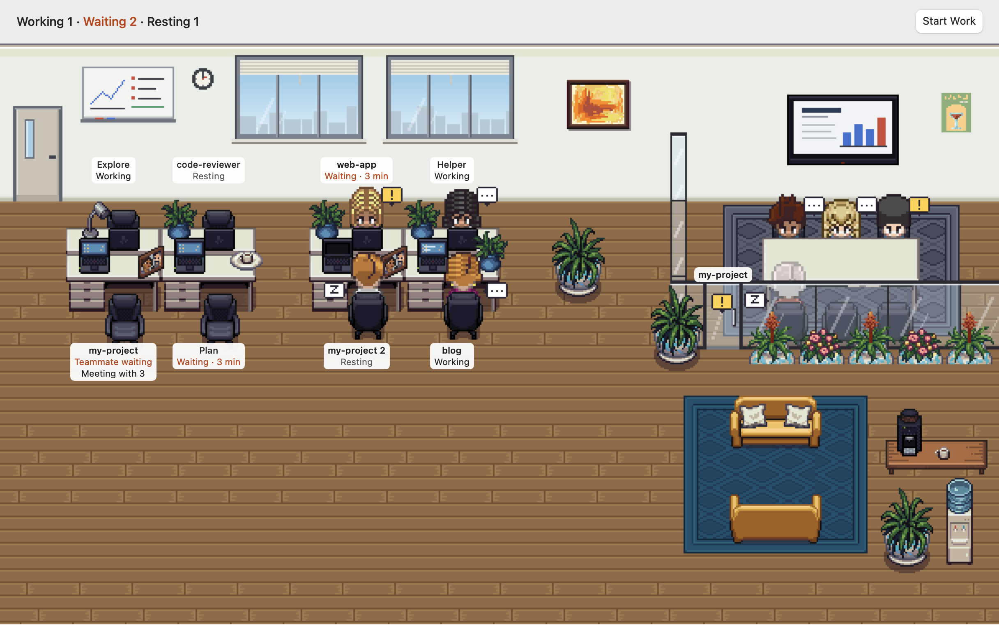

# Agent Overtime

English · [한국어](README.ko.md)

**Your agents' office, lights on all night.** A small macOS app that shows your Claude Code sessions and their subagents at work in a pixel office: who is working, who is waiting for your answer, who is resting, and who has gone home.

Works with Claude Code. Not affiliated with Anthropic.

<picture>
  <source media="(prefers-color-scheme: dark)" srcset="docs/images/office-dark.png">
  
</picture>

| State | What it means | What you see |
|---|---|---|
| Working | Producing an answer | Sitting at the desk, laptop on, `…` bubble |
| Waiting · n min | Needs your permission or answer | Still sitting, a `!` bubble hopping over the head |
| Resting | Done, waiting for your next instruction | Nodding off in the chair, `z` bubble |
| Off duty | The session ended | Walks out the door; while others still work at that island, its seat keeps a dimmed name tag |

- People sit at islands of four facing desks, nearest the door first, only while they work. A session's name tag is its folder's name; a second session in the same folder is "name 2".
- Subagents walk in and sit at the island of whoever called them. The caller walks over to hand out the work, and a subagent that finishes walks over to report before it leaves. When a session hands work to two or more subagents and waits, they meet in the glass meeting room.
- Click a character or its name tag for a side panel: the state and for how long, the kind of tool in use, the subagents. ✏️ there gives a nickname, kept on this Mac.
- The menu bar icon turns into `! 2` while sessions wait for you. Everything stays on this Mac.

## Start here

### 1. Install

```
brew install --cask ykwimk/tap/agent-overtime
```

Or download the `.dmg` from [Releases](https://github.com/ykwimk/agent-overtime/releases) and drag `AgentOvertime.app` into **Applications**. Keep its name: the plugin looks for `/Applications/AgentOvertime.app` or `~/Applications/AgentOvertime.app`.

### 2. First launch

The first launch is blocked because the app is not notarized by Apple. Open **System Settings > Privacy & Security**, click **Open Anyway** at the bottom, then **Open**. On macOS 13 and 14, right-click > **Open** in Finder also works; from macOS 15 the System Settings route is the only one.

### 3. Connect

Click **Copy Connect Commands** in the app's first window and paste the two lines into Claude Code:

```
/plugin marketplace add ykwimk/agent-overtime#v0.2.0
/plugin install agent-overtime@agent-overtime
```

When Claude Code asks, choose **Install for you (user scope)** so it applies to every project on this Mac. Sessions that were already open need `/reload-plugins` once.

### 4. One-minute check

Send Claude Code one message. A character walks in through the office door and sits at a desk named after your folder (for `~/my-project`, the desk says `my-project`). Nothing after 30 seconds? See the first question below.

## FAQ

**Homebrew says "untrusted tap".**
Run the install command again with the full name: `brew install --cask ykwimk/tap/agent-overtime`. With the full name, Homebrew trusts only this app, not the whole tap, and installs it.

**My character doesn't show up.**
Is agent-overtime turned on in Claude Code's `/plugin` list? Was the session already open (type `/reload-plugins` in it once)? Is the app in the Applications folder? Did you send Claude Code a message after installing?

**A session I opened earlier isn't in the office.**
Type `/reload-plugins` in it once. Sessions opened before the app appear the next time they move.

**Why does macOS block the app? Is it safe to open?**
Notarization needs Apple's paid developer program, which this project doesn't use yet. The code is public, and you can check that your download matches the release (see [Verify the download](#verify-the-download)).

**I allowed a permission, but it still says Waiting.**
Claude Code sends no separate "allowed" event, so the state changes at the session's next event (a few minutes for a long command).

**Does it work with other agents?**
Not yet. Only Claude Code for now; other agents are on the [roadmap](#roadmap).

**How do I turn it off or remove it?**
Turn off or remove `agent-overtime` with `/plugin` in Claude Code. Then `brew uninstall --cask agent-overtime` or move the app to the Trash; its data is in `~/Library/Application Support/AgentOvertime`.

## Similar apps

| | What it shows | Where it runs | Install | How it knows the state | Network | License |
|---|---|---|---|---|---|---|
| Agent Overtime | Claude Code sessions and subagents you already started, in four states; waiting count in the menu bar | Mac app (office window and menu bar), macOS 13+ | Homebrew cask or `.dmg`, then two plugin lines | Plugin hooks send to a socket on your Mac | None, no ports opened | MIT (art: OGA-BY 3.0 and CC0) |
| [Pixel Agents](https://github.com/pixel-agents-hq/pixel-agents) | Coding agents in your terminals as pixel characters in a small office; subagents and teammates as their own characters; bubbles when waiting for input or permission. Launches Claude Code from the office | VS Code extension, or a standalone CLI that serves the office to your browser. Windows, Linux, macOS | VS Code Marketplace or Open VSX, or `npx pixel-agents` (Node.js 20+) | Hooks; reads session transcripts when hooks are unavailable and for details not in an event. Also picks up sessions started outside it | Standalone CLI: local server on a free port, `127.0.0.1` by default | MIT |
| [Outworked](https://github.com/outworked/outworked) | Claude as a team of AI employees: hire agents, describe a goal, and watch them write code, use the web, send messages and run scheduled tasks in an office | Desktop app (Electron), macOS first; release builds for Apple Silicon | Its own Homebrew tap, or `.dmg`; needs Claude Code installed and signed in | Runs its own agents through the Claude Code SDK. Showing sessions started elsewhere: — | Yes, for its features: auto-updates; tunnels (downloads cloudflared on first use), webhook triggers, a built-in browser, Slack and iMessage | GPL-3.0 |

From each project's README, November 2026. If something here is wrong, please open an issue.

- Another app fits better if you want the office inside VS Code, on Windows or Linux, or want to launch agents from it (Pixel Agents), or want an app that runs a team of agents toward a goal for you (Outworked).
- What this app can't do: it works with Claude Code only and on macOS only, it isn't notarized yet, and it never starts agents or gives them work. It only shows the sessions you run.

## How it works

1. The plugin adds hooks for nine Claude Code events (`SessionStart`, `UserPromptSubmit`, `PreToolUse`, `PermissionRequest`, `Notification`, `Stop`, `SubagentStart`, `SubagentStop`, `SessionEnd`; see [`plugin/hooks/hooks.json`](plugin/hooks/hooks.json)). Each one runs a small helper inside the app, `agent-overtime-hook`.
2. The helper keeps only: event name, session id, folder path, subagent id and name, notification type, whether the tool is AskUserQuestion or SendMessage, the recipient of a SendMessage (its `to` field only), a tool kind (one of: reading, editing, command, search/web, teammates, other), and the Claude Code process id. Tool names, the message itself and all other tool input, prompts, file contents and transcripts are dropped right after parsing; they are never stored or sent. The recipient is only matched against teammates already at a desk, then dropped; it is never saved or shown. The tool kind is worked out inside the helper from a fixed list of Claude Code's built-in tools. MCP tools and any tool it does not know count as "other", so MCP server names never leave the helper. The app keeps only the latest kind and when it arrived, in memory. The transcript file is never opened.
3. The helper hands the values to the app over a unix socket only your user can open (folder 0700, file 0600). It prints nothing and always exits within 0.5 s.
4. The app only changes the picture, and nothing in an event is ever run. The screen shows states and a coarse tool kind (for example "Editing files") only, never tool names, commands or file paths.

- Meetings are a picture of a session handing out work: when it has two or more subagents out and does nothing of its own for 10 seconds, they meet in the meeting room. The app never knows what anyone says, so speech bubbles stay empty.
- Network: none. No ports, no update checks, no analytics, no crash reports.
- On disk: `~/Library/Application Support/AgentOvertime/config.json` (0600) with recent folders (folder paths), your start command, and the nicknames you give sessions (by folder path) and teammates (by name), plus the app's preferences (whether it has connected, and the fingerprint of the start command you approved). Nicknames stay on this Mac: they never go to the hook helper, a log or a notification. Clear them in Settings > Nicknames, and recent folders in Settings > Recent Folders.

## Verify the download

Each release note lists the SHA-256 of its `.dmg`. Compare it with:

```
shasum -a 256 ~/Downloads/AgentOvertime*.dmg
```

Homebrew checks the same value from the cask on its own.

## Updates

- The app never checks for updates. To hear about new versions, use **Watch > Custom > Releases** on this repository.
- Homebrew: `brew upgrade --cask agent-overtime`. `.dmg`: download the new one and replace the app in Applications.
- Each release pins its own tag in the connect commands. To move the plugin to the new tag, run these in Claude Code in this order (`vX.Y.Z` is the new tag; the updated app's Settings > **Copy Connect Commands** has the last two lines filled in), then restart the Claude Code sessions you have open:

```
/plugin marketplace remove agent-overtime
/plugin marketplace add ykwimk/agent-overtime#vX.Y.Z
/plugin install agent-overtime@agent-overtime
```

`remove` also uninstalls the plugins installed from that marketplace; the last line installs agent-overtime again.

## Start Work

An optional button that runs one command you register (for example `claude`) in a folder you choose, in a new Terminal window.

- The setup sheet is the confirmation: the folder and each argument on their own line, never truncated, hidden characters spelled out (e.g. `⟨U+200B⟩`).
- The approved fingerprint lives outside the config file. If `config.json` changes outside the app, the next start shows the command again for confirmation.
- The command is written as a single-quoted `.command` file (0700, deletes itself first) and opened by Terminal. The app never adds options to your command.
- If a session is already running in that folder (or below it), the app asks before starting one more.

## Build it yourself

Xcode 16 or later, macOS 13 or later.

```
swift format lint --recursive App AppTests Helper Sources Tests tools Package.swift
swift test
xcodebuild -project AgentOvertime.xcodeproj -scheme AgentOvertime -configuration Release -derivedDataPath build build
xcodebuild -project AgentOvertime.xcodeproj -scheme AgentOvertime -derivedDataPath build test   # app tests, screenshots in captures/
swift run fake-events   # sends made-up events to the running app, no Claude Code needed
```

Move `build/Build/Products/Release/AgentOvertime.app` into **Applications** (or `~/Applications`), then continue from [3. Connect](#3-connect).

## Roadmap

- Jump from a character's side panel to that session's terminal
- A small always-on-top window
- Other agents such as Codex, once enough people ask in issues

## License

- Code: MIT (see [LICENSE](LICENSE)).
- Art (`App/Art/`): not MIT. Full credits: [`App/Art/CREDITS.txt`](App/Art/CREDITS.txt).
  - The room and furniture: LPC Revised by Eliza Wyatt and contributors (Lanea "Sharm" Zimmerman and others), OGA-BY 3.0. Cropped by Agent Overtime contributors.
  - The people (`App/Art/MetroCity/`): MetroCity Free Top Down Character Pack by JIK-A-4, CC0 1.0 (no attribution required, credited anyway). Layered, cut and slightly recoloured while drawing by Agent Overtime contributors.
